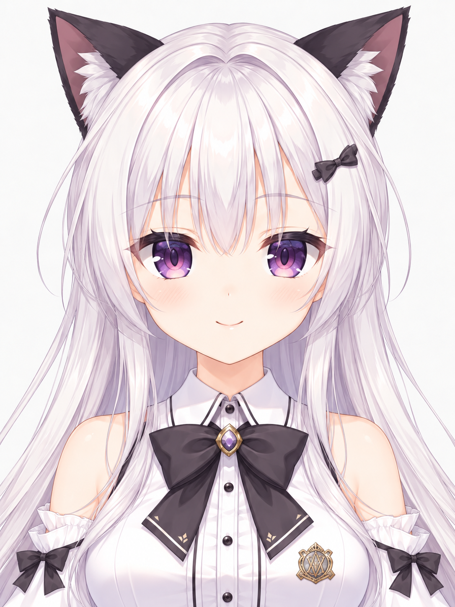

# VTuberTailor｜從一張角色圖到可動 V 皮

保留角色神韻，把原圖與透明素材整理成可追溯的 2D VTuber 模型：拆件、遮擋補繪、像素配準、綁定、疊圖驗收，以及 VTube Studio 交付。

本 repo 本身就是一個完整 Skill。`SKILL.md` 是入口；`references/` 收錄按需流程；`scripts/` 提供可重複執行的工具；`vendor/puppetloom/` 保存包含本次修正的引擎原始碼。執行時不需要另一份 PuppetLoom checkout。此為獨立專案，非 PuppetLoom 官方分支；來源及 AGPL-3.0-or-later 授權見 [NOTICE.md](NOTICE.md)。

## 實際案例：一張角色圖的製作旅程

從一張角色圖出發，透過 AI 重繪與補件、透明素材拆層、像素對位、綁定及疊圖驗收，逐步製作出可動 V 皮。這次案例也另外生成大頭照，作為臉部神韻與頭髮細節的參考，再整理成 VTube Studio 模型套件。

| 透明全身來源參考 | 大頭照與臉部基準 | 早期測試版 r32 |
| --- | --- | --- |
|  |  |  |
| 最初分層專案保留的透明合成參考圖。 | 重繪後確認的造型與臉部錨點。 | 由官方 Core 幾何讀回與匯出貼圖渲染，非 VTS 視窗截圖。 |

以上三張展示圖由使用者明確指定公開，原像素未重繪或修飾；完整角色專案與個人 VTS 設定仍留在本機。來源與 SHA-256 見 [assets/examples](assets/examples/README.md)。

r32 是早期測試結果；後續 VTube Studio 實測仍發現頭部、五官與髮絲連動及頸部接縫問題，修復與真人追蹤驗收仍在進行。離線渲染圖不能證明角色動作已完成。

## 本機準備（Windows）

需要 PowerShell 7.4+、Python 3.12+，以及引擎支援的 Node 24.22.1（24.x）或 >=26.12.1。預設安裝的鎖定 NumPy 版本要求 Python 3.12 以上。MOC/CMO3 匯出另需要 Java 21+；官方 Core 驗證使用你已安裝的 VTube Studio／Cubism Core DLL。

```powershell
git clone https://github.com/Gale0418/VTuberTailor.git
cd VTuberTailor
./scripts/tailor.ps1 setup -NodePath <node.exe> -PythonPath <python.exe>
# 若要匯出 Cubism：
./scripts/tailor.ps1 setup -JavaPath <java.exe> -WithExporter
./scripts/tailor.ps1 doctor --require-exporter --json
./scripts/install_skill.ps1
```

首次 setup 把 Node/npm 複製進本專案的 `.runtime/`，以 lockfile 建立新的 workspace links、建置引擎，並建立 Python QA venv。原生 exporter 的依賴以鎖定 SHA-256 驗證，在本機 cache 取得，SDK binary 不放進 GitHub。`setup` 可重跑；變更 package lock 時才重裝 npm 依賴，使用 `-ForceInstall` 可明確重建。

npm 優先從指定 Node 的同目錄尋找，再查 PATH；自訂安裝可另傳 `-NpmCliPath <npm/bin/npm-cli.js>`。搬動 repo 後，重跑 `setup -WithExporter`，更新本機 exporter 的絕對 cache 路徑。

`install_skill.ps1` 在使用者的 Codex skills 目錄建立指向完整 repo 的 junction。不要只複製 `SKILL.md`：本 Skill 的 scripts 和 vendor 是必要資源。重新開啟或重新整理 Skill 後，以 `$vtuber-tailor` 使用。

可用 `-Destination <實際 skills 目錄/vtuber-tailor>` 指定其他 Skill 探索位置（例如新版 Codex 的使用者 `.agents/skills`），避免安裝多個同名副本。

## 工具入口

```powershell
./scripts/tailor.ps1 help
./scripts/tailor.ps1 engine capabilities --json
./scripts/tailor.ps1 smoke --output <新的測試資料夾>
./scripts/tailor.ps1 inspect <RGBA.png> --roi <x,y,width,height> --panels <檢查圖.png>
./scripts/tailor.ps1 compare <原圖.png> <成品.png> --out <新的疊圖目錄> --scale 1 --tx 0 --ty 0
./scripts/tailor.ps1 verify-native --project <模型目錄> --export <匯出目錄> --core <Live2DCubismCore.dll>
./scripts/tailor.ps1 package-vts --export <匯出目錄> --output <新套件目錄> --name <角色名> --preset <既有model.vtube.json>
```

傳給 `engine` 的專案／輸入／輸出請用絕對路徑，因引擎命令以 vendor 目錄為工作目錄。各工具的 `--help` 列出精確參數；`register` 是 `engine assets register` 的簡寫。

本機另有試驗性的 model3/moc3 靜態預覽入口：使用者自行準備已核驗的 PurismCore Web runtime，執行 `node scripts/purism-preview/server.mjs --runtime-root <runtime 目錄>`，再開啟輸出的 localhost 網址。也可選擇用整合入口把連結加入 Anime2.5DRig 的程式快照；原始頁面及 VTS 不會被自動修改。模型物理、動作與攝影機追蹤未在此入口驗證。準備方式、安全邊界及已知限制見 [references/purism-preview.md](references/purism-preview.md)。

固定 frame 的疊圖用來揭露差異，不會自動把眼睛局部拉伸到「看起來符合」。透明像素任意 RGB 不當作可見缺陷；亮膚色也不應因色差門檻被挖成透明洞。生圖／Python 編修依當次使用者授權選擇，Skill 不攜帶其他角色過去的永久授權。

## 驗證與資料

- `doctor` 檢查實際 Node、Python、workspace links、建置身分及 exporter classpath。`--forbid-root <已退役目錄>` 會拒絕任何仍解析回該目錄的執行依賴。
- `smoke` 從隨附的合成 PSD 建立另一個專案、驗證並渲染，不修改使用者角色。
- `verify-native` 用官方 Core 真正讀回 MOC，並渲染輸出 atlas。這和 VTS 實機截圖是不同證據；未經 Editor 開啟另存的 CMO3 也會明確標示。
- `package-vts` 保留指定 preset 的追蹤與位置設定，僅更新新模型必要欄位。它不自動安裝、啟動 VTS 或改安全／攝影機設定。
  `--icon`、`--idle`、`--idle-lost` 會複製對應素材；沒有提供時清空相應的舊檔案引用，避免新套件指向不存在的圖示或動畫。
- `engine performance` 會短暫顯示一般預覽視窗以量測實際幀率，並保存畫布截圖；這不是全螢幕電腦操作，也不是 VTS 實機測試。
- `projects/`、`.runtime/`、`local-reports/`、封存及角色原圖預設不進 git。角色資料留在使用者選定的專案目錄；公開範例僅限本次指定的 `assets/examples/` 三張圖。

本機遷移／刪除舊工作區時，先依使用者指定的範圍保留並驗證必要原始碼、角色素材及成品，再把舊路徑移開進行冷啟動、建模、渲染及匯出測試，通過才刪除。完整歷史封存可使用 `archive_workspace.py`，未完成驗證的 ZIP 不可當作備份。詳細步驟見 [references/migration-and-vts.md](references/migration-and-vts.md)。

## 開發檢查

```powershell
./scripts/test.ps1
./scripts/test.ps1 -Engine
```

第三方引擎原有授權與 notices 保留在 `vendor/puppetloom`。snapshot 的 upstream commit、檔案來源及本機修改記錄見 `upstream.json`、`vendor/puppetloom-source-manifest.json`、`vendor/puppetloom/VTUBERTAILOR_CHANGES.md`。

本次完整流程的已執行項目與限制見 [references/validation.md](references/validation.md)。

本輪維護狀態以 [MissionCenter/tasks.md](MissionCenter/tasks.md) 為準。外部審查先用相同程式碼的隔離副本排除私有資料、素材、生成物與鎖檔，每輪最多 150 檔、每小時最多 3 次；審查意見經本機查證後才修正。

[2026-10-26 CodeRabbit 紀錄](references/code-review-2026-10-26.md)：兩輪共審查 150 檔來源範圍及 15 檔修補 diff，10 項問題修正、1 項以反證拒絕，並完成整合建置與搬移匯出驗證。

2026-11-03 另完成一次針對 46 個程式／測試檔的 CodeRabbit 審查，2 項問題（`relay-info` 雙斜線與 Windows `tmpdir`）均已修正。當前 Node 測試為 80 pass／12 skip，calibration overrides 為 19/19；這批結果使用 Node 22，非專案宣告版本的正式驗證。macOS 執行 `test.ps1 -Engine` 會因 Windows Python runtime 失敗，系統 Python 3.9 亦缺少 NumPy；以 Python 3.11 搭配既有、非 lock 精確版本的 cache 依賴所做 image QA 與 archive smoke 分別為 7/7、4/4。已核驗 runtime 的 synthetic editor integration 實際 14/14 pass、0 skip，但不代表 VTS／實機驗收；其他完整驗收仍待執行，尚不宣稱整體通過。

2026-11-03 engine suite（Mac／Node 22）更新：原始 suite 為 53/56 test files、372/379 tests 通過；3 項缺 Windows 指定 `Java.exe`、3 項需要 Windows Photoshop COM，原始 60 秒測試仍不通過。依 111 秒實測，正式專案 `vendor/puppetloom/packages/core/test/eye-closure-proposal.test.ts` 的個別上限已由 60 調至 180 秒；獨立診斷副本該測項 1/1 通過、耗時約 111 秒，其餘來源相同。正式測試尚未完整重跑，原 suite 結果不變，不能標成全過。

引擎測試有 Windows 路徑長度預算；包裝腳本使用較短的 runtime 產物根目錄，必要時改用系統 temp。也可明確設定 `PUPPETLOOM_ARTIFACT_ROOT` 為較短路徑，不會放寬原有長度或安全門檻。
